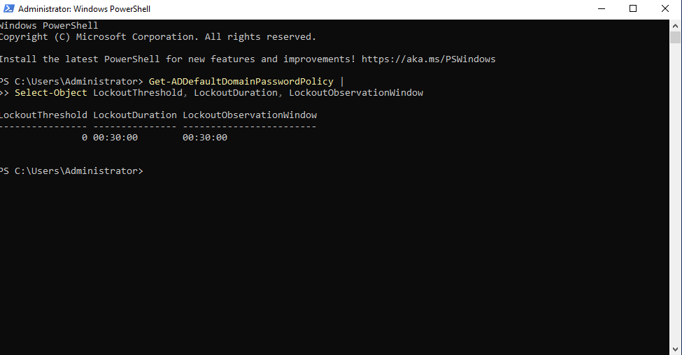
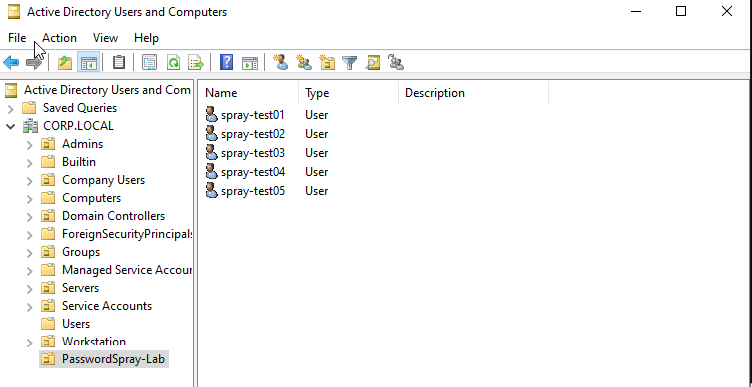
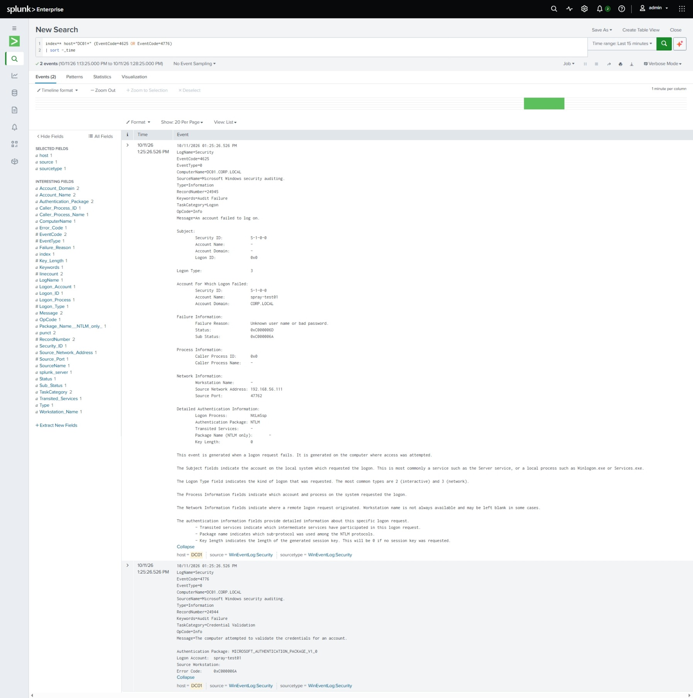
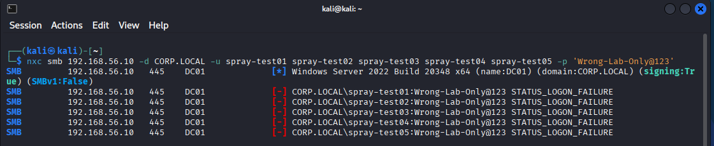
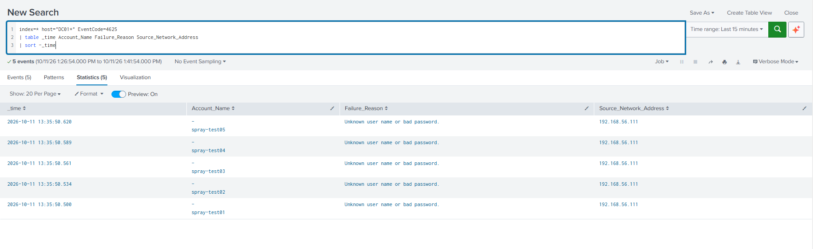
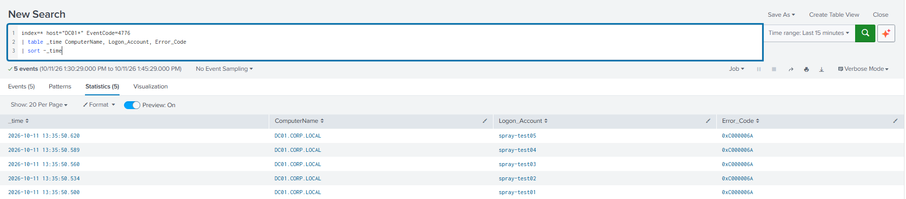
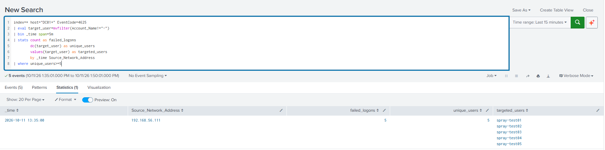
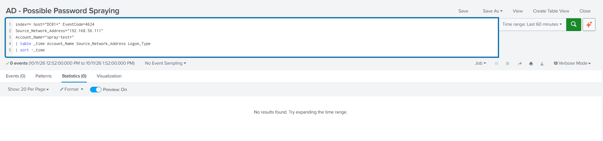

# Active Directory Password Spraying Detection

## Detection Summary

This lab simulates password spraying against five Active Directory accounts and investigates the resulting Windows Security events in Splunk.

NetExec was used from Kali Linux to attempt SMB authentication against DC01 using one deliberately incorrect password across five test accounts.

**Outcome:**
- All five authentication attempts were rejected.
- Events 4625 and 4776 were identified in Splunk.
- The detection query returned one source IP targeting five distinct accounts within a fixed five-minute interval.
- A follow-up search returned no matching successful logons within the selected time range.
- The detection was saved as a manually executed Splunk report.
- The five test accounts were deleted after the exercise.

This was a controlled lab simulation. No automated alert was implemented.

## Lab Environment

| Component | Role | Address |
|---|---|---|
| DC01 — Windows Server 2022 | Domain controller and authentication target | 192.168.56.10 |
| Windows 10 | Splunk host | 192.168.56.110 |
| Kali Linux | Source of simulated authentication attempts | 192.168.56.111 |
| CORP.LOCAL | Active Directory domain | — |
| NetExec | SMB authentication testing | — |
| Splunk Universal Forwarder | Security log forwarding | — |

Test accounts: `spray-test01` through `spray-test05`.

## Preparation

### Check the Default Domain Lockout Policy

Executed on DC01:

```powershell
Get-ADDefaultDomainPasswordPolicy |
Select-Object LockoutThreshold, LockoutDuration, LockoutObservationWindow
```

Observed:

| Setting | Value |
|---|---|
| LockoutThreshold | 0 |
| LockoutDuration | 00:30:00 |
| LockoutObservationWindow | 00:30:00 |

The default domain policy did not enable account lockout after failed attempts. The policy was inspected without changing it for this exercise.

### Configure Failure Auditing

Initial checks showed Success auditing for Kerberos Authentication Service and Credential Validation, and Success and Failure for Logon.

Failure auditing was enabled for the first two categories:

```powershell
auditpol /set /subcategory:"Kerberos Authentication Service" /failure:enable
auditpol /set /subcategory:"Credential Validation" /failure:enable
```

The settings were checked again after the change.

The SMB test produced NTLM authentication evidence; enabling Kerberos failure auditing does not mean this test used Kerberos.

### Create Test Accounts

Five ordinary test accounts were created manually through Active Directory Users and Computers in the `PasswordSpray-Lab` OU:

- spray-test01
- spray-test02
- spray-test03
- spray-test04
- spray-test05

The password used for the simulation was deliberately different from the accounts' actual passwords.

## Simulation

### Initial Single-Account Test

From Kali Linux:

```bash
nxc smb 192.168.56.10 -d CORP.LOCAL -u spray-test01 -p 'Wrong-Lab-Only@123'
```

NetExec returned `STATUS_LOGON_FAILURE`.

One Event 4625 and one Event 4776 were found for the initial test. These represented different audit records associated with the same authentication attempt.

### Five-Account Test

```bash
nxc smb 192.168.56.10 -d CORP.LOCAL -u spray-test01 spray-test02 spray-test03 spray-test04 spray-test05 -p 'Wrong-Lab-Only@123'
```

All five attempts returned `STATUS_LOGON_FAILURE`.

The password shown above is the deliberately incorrect test value, not a valid account credential.

## Evidence Analysis

### Event 4625 — Failed Logon

The initial expanded event showed:

| Field | Observed Value |
|---|---|
| Target account | spray-test01 |
| Logon Type | 3 — Network |
| Authentication Package | NTLM |
| Source Network Address | 192.168.56.111 |
| Status | 0xC000006D |
| SubStatus | 0xC000006A |
| Failure Reason | Unknown user name or bad password |

The five-account test produced five Event 4625 records, one for each test account, from the same source IP.

Their displayed timestamps ranged from `2026-10-11 13:35:50.500` to `2026-10-11 13:35:50.620`.

### Event 4776 — Credential Validation

Five credential-validation failures were also identified on `DC01.CORP.LOCAL`.

Each test account appeared under `Logon_Account`, with error code `0xC000006A`, indicating an incorrect password.

Source IP attribution in this investigation came from Event 4625. The 4776 evidence provided supporting credential-validation information.

The two event types were not summed as separate authentication attempts.

## Splunk Searches

### Review Failed Logons

```spl
index=* host="DC01*" EventCode=4625
| table _time Account_Name Failure_Reason Source_Network_Address
| sort -_time
```

### Review Credential Validation

```spl
index=* host="DC01*" EventCode=4776
| table _time ComputerName Logon_Account Error_Code
| sort -_time
```

### Detect Possible Password Spraying

```spl
index=* host="DC01*" EventCode=4625
| eval target_user=mvfilter(Account_Name!="-")
| bin _time span=5m
| stats count as failed_logons
        dc(target_user) as unique_users
        values(target_user) as targeted_users
        by _time Source_Network_Address
| where unique_users>=5
```

Detection logic:

1. Select failed logon events from DC01.
2. Remove the placeholder `-` from the multivalue `Account_Name` field.
3. Group events into fixed five-minute intervals.
4. Count failed logons and distinct account names for each source IP.
5. Return groups containing at least five distinct accounts.

Observed result:

| Interval Start | Source IP | Failed Logons | Distinct Accounts |
|---|---|---|---|
| 2026-10-11 13:35:00 | 192.168.56.111 | 5 | 5 |

The result listed all five test accounts.

The displayed `13:35:00` is the start of the aggregation interval, not the exact timestamp of an authentication attempt.

### Check for Successful Logons

```spl
index=* host="DC01*" EventCode=4624
Source_Network_Address="192.168.56.111"
Account_Name="spray-test*"
| table _time Account_Name Source_Network_Address Logon_Type
| sort -_time
```

The retained screenshot shows zero results for the displayed range of `2026-10-11 12:52:00`–`13:52:00`, covering the simulation and a period afterward.

This search found no matching successful logons in the available data for that interval. It does not establish the absence of successful activity outside its host, account, source-IP and time filters.

## Saved Report

The detection was saved as:

**AD - Possible Password Spraying**

The report was reopened and successfully executed during the exercise.

The lab was using Splunk Free following expiration of the Enterprise trial. Automated alerting was unavailable, so this implementation uses a manually executed report.

## False Positives and Limitations

- Shared source IPs, authentication gateways, authorized testing and misconfigured applications can produce failures involving multiple accounts.
- Windows authentication logs do not reveal whether the same password was attempted. The common password is known from the controlled simulation.
- The threshold of five accounts is a lab setting and requires tuning for another environment.
- Fixed time buckets can split activity across interval boundaries.
- Slow or distributed spraying may remain below this threshold.
- Removing `-` from `Account_Name` worked for the observed events. Other environments should explicitly extract the target account from the failed-logon section to avoid mixing subject and target identities.
- Events without a usable source IP will not be reliably covered by this grouping.
- `index=*` should be replaced with the intended Security log index in a deployed rule.
- The query was validated against this simulation; broader benign-activity testing was not completed.

## Cleanup

The five test accounts were deleted through Active Directory Users and Computers after the exercise.

Historical events and the saved report were retained.

## Screenshots

### 01 — Default Domain Lockout Policy



### 02 — Test Accounts



### 03 — Initial Authentication Test

Expanded Security events from the single-account test.



### 04 — Password Spraying Simulation

Five rejected authentication attempts from Kali Linux.



### 05 — Failed Logons: Event 4625



### 06 — Credential Validation: Event 4776



### 07 — Aggregated Detection Result



### 08 — Successful Logon Check



## Lessons Learned

- Multiple audit records can describe one authentication attempt.
- Counting distinct targeted accounts helps identify a spraying pattern.
- Multivalue field extraction must be checked before counting identities.
- A follow-up success search helps assess whether failed attempts were followed by access.
- A working detection query and an automated alert are separate implementation stages.
