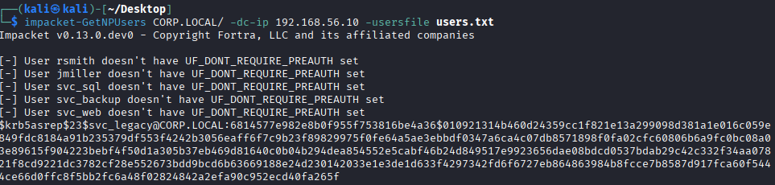
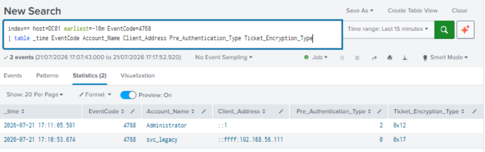

# AS-REP Roasting Detection

## Detection Summary

| Field | Value |
|------|------|
| Attack | AS-REP Roasting |
| MITRE ATT&CK | T1558.004 |
| Platform | Active Directory 
| Detection Platform | Splunk Enterprise 
| Windows Event IDs | 4768 |
| Status | ✅ Successfully Simulated 

---

# Objective

Detect AS-REP Roasting attempts by identifying Kerberos Authentication Service (AS) ticket requests for user accounts that do not require Kerberos pre-authentication.

---

# MITRE ATT&CK

| Technique | ID |
|-----------|----|
| AS-REP Roasting | T1558.004 |

---

# Lab Environment

| Machine | Role |
|---------|------|
| Kali Linux | Attacker |
| DC01 | Domain Controller |
| WIN10 | Splunk Enterprise |

Domain:

```
corp.local
```

---

# Attack Overview

AS-REP Roasting targets Active Directory user accounts that have the **"Do not require Kerberos preauthentication"** option enabled.

Unlike Kerberoasting, the attacker does **not** need valid credentials. The attacker simply requests an Authentication Service (AS-REP) response from the Domain Controller. The response contains data encrypted with the user's password hash, allowing offline password cracking.

---

# Vulnerable Configuration

The following account was configured with:

- **Do not require Kerberos preauthentication**

Example:

```
svc_legacy
```

---

# Attack Execution

### User Enumeration

```bash
nano users.txt
```

Example:

```text
rsmith
jmiller
svc_sql
svc_backup
svc_web
svc_legacy
```

### Request AS-REP Hashes

```bash
impacket-GetNPUsers CORP.LOCAL/ \
-dc-ip <target_ip> \
-usersfile users.txt
```

Result:

Successfully obtained an **AS-REP hash**:

```
$krb5asrep$...
```

---

# Evidence Collected

Windows Security Log

Event ID:

- 4768 (Kerberos Authentication Ticket Request)

Relevant fields:

- Account Name
- Client Address
- Ticket Encryption Type
- Pre-Authentication Type

---

# Splunk Detection

Basic search

```spl
index=* host=DC01 EventCode=4768
```

Detection search

```spl
index=* host=DC01 EventCode=4768
| table _time Account_Name Client_Address Ticket_Encryption_Type Pre_Authentication_Type
```

---

# Detection Logic

An attacker requesting AS-REP responses for accounts without Kerberos preauthentication generates Kerberos Authentication Service (4768) events. They occur with Pre-Authentication-Type 0.

Repeated requests from a workstation for multiple accounts may indicate reconnaissance or AS-REP Roasting activity.

---

# MITRE Mapping

Credential Access

T1558.004

---

# Mitigation

- Require Kerberos preauthentication for all users.
- Regularly audit accounts with preauthentication disabled.
- Use strong passwords.
- Monitor unusual 4768 activity.

---

# Screenshots

### Impacket Output



### Splunk Detection



*A separate Event Viewer screenshot is not included in this repository.*

---

# Lessons Learned

This lab demonstrates how attackers can retrieve Kerberos AS-REP responses from improperly configured Active Directory accounts without valid credentials.

The activity was successfully collected through the Splunk Universal Forwarder and detected in Splunk Enterprise using Windows Security Event ID 4768.
