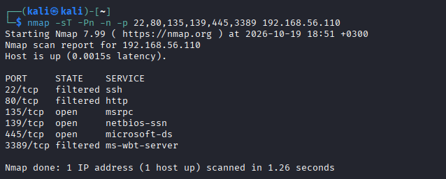
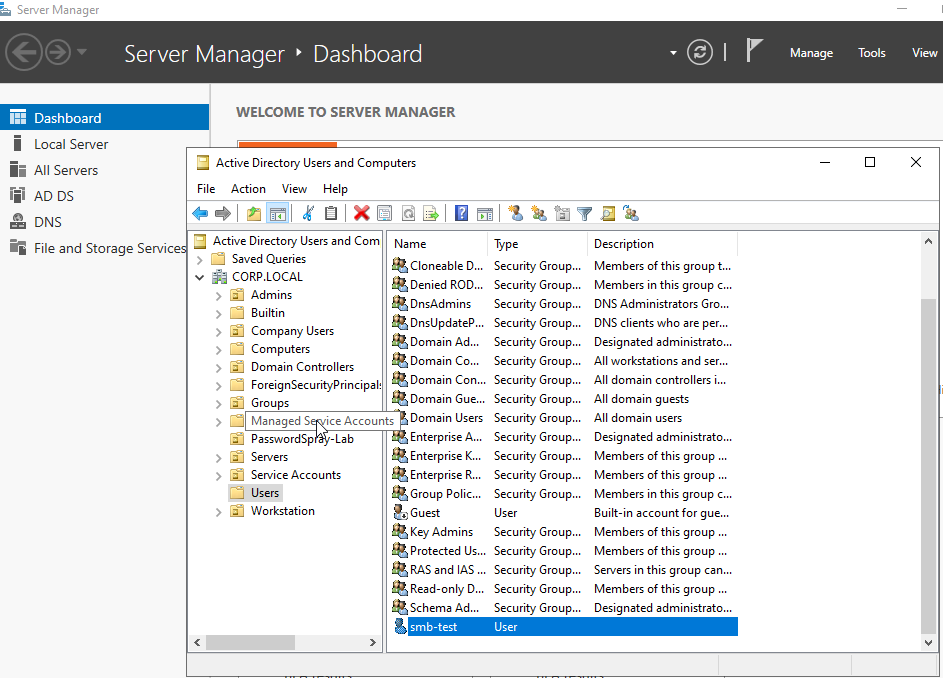
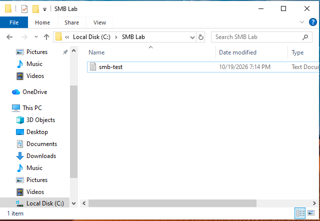
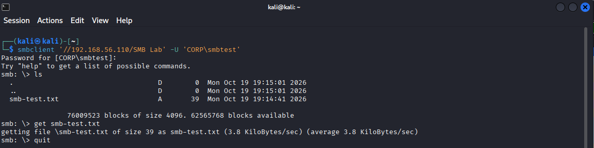
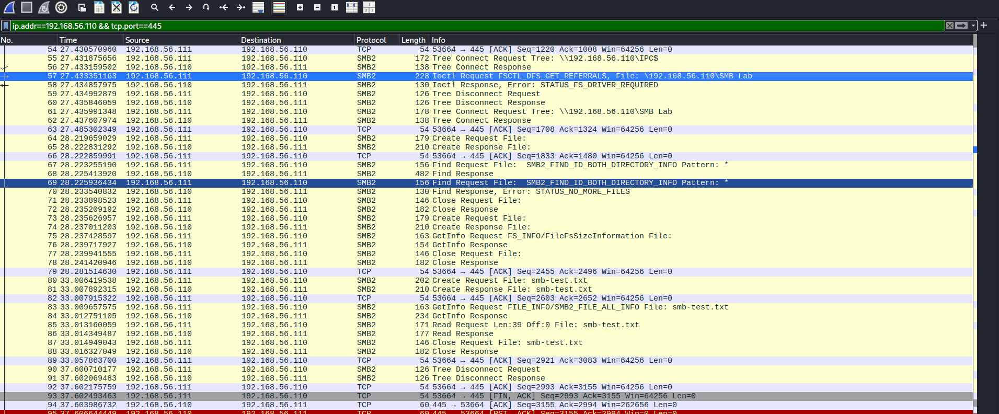
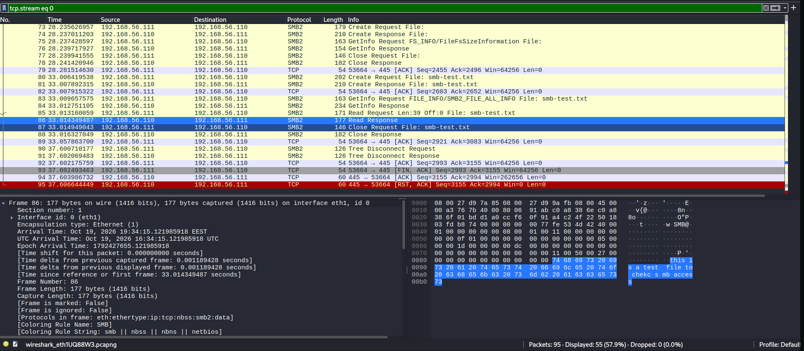
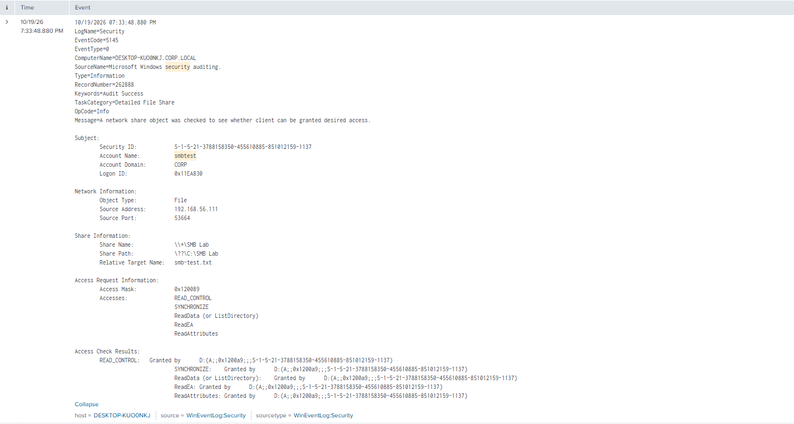
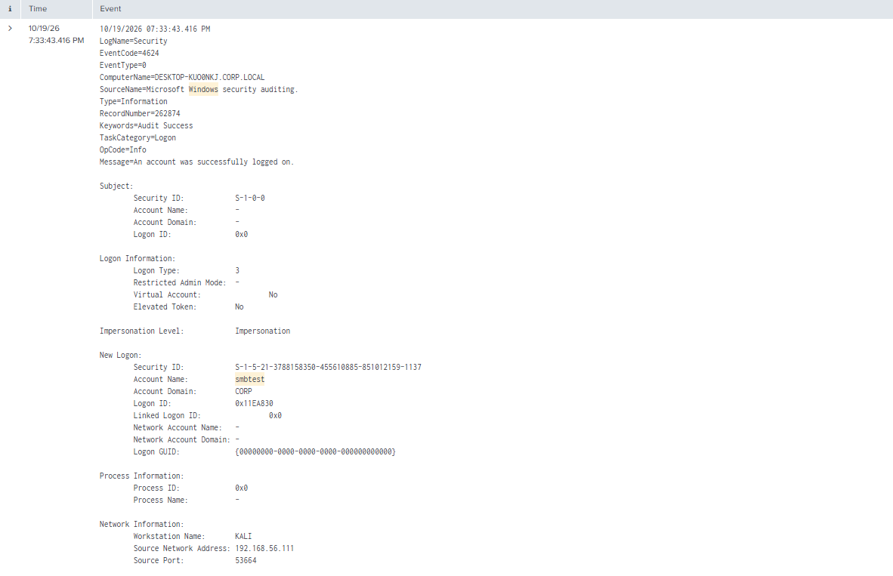

# Network Reconnaissance and SMB Activity Investigation

## Detection Summary

This lab investigates a TCP connect scan followed by authenticated SMB file access from Kali Linux to a Windows 10 endpoint. Wireshark packet evidence was compared with Windows Security events in Splunk.

**Outcome:**

- Nmap identified ports 135, 139 and 445 as open; 22, 80 and 3389 were filtered.
- The ordinary domain account `CORP\smbtest` accessed the SMB Lab share and downloaded a 39-byte text file.
- Wireshark showed the file open, read and close sequence, including the returned contents.
- Events 4624 and 5145 were correlated on the same endpoint using Logon ID, account, source IP and source port.
- Event 5140 was also found during the live investigation.
- A manual Splunk report was saved. The test folder/share and account were deleted afterward.

This was authorized lab activity. The case demonstrates investigation of SMB access, not proof of malicious intent or an automated alert.

---

## Objective

- Distinguish TCP connectivity from authenticated application activity.
- Inspect SMB share access and file reading.
- Identify the account and source responsible for access.
- Correlate Windows Security events with packet evidence.
- Document a reproducible investigation workflow and its limits.

---

## MITRE ATT&CK

| Technique | ID | Relevance |
|---|---|---|
| Network Service Discovery | [T1046](https://attack.mitre.org/techniques/T1046/) | Controlled scan of six TCP ports |
| Data from Network Shared Drive | [T1039](https://attack.mitre.org/techniques/T1039/) | Controlled retrieval of a file from an SMB share |

These mappings describe behaviors that can also occur during an intrusion. Access in this exercise was authorized. No remote code execution or external exfiltration was demonstrated.

---

## Lab Environment

| Component | Role | Address |
|---|---|---|
| DC01 — Windows Server 2022 | Active Directory domain controller | 192.168.56.10 |
| Windows 10 — DESKTOP-KUOONKJ | SMB target and Splunk host | 192.168.56.110 |
| Kali Linux | Nmap, smbclient and Wireshark | 192.168.56.111 |
| CORP.LOCAL | Active Directory domain | — |
| Splunk Universal Forwarder | Windows Security log forwarding | — |

Wireshark captured traffic on Kali's `eth1` interface. The virtual machines communicate over the VirtualBox host-only network.

---

## Attack Overview

The controlled sequence was:

1. Scan selected TCP ports on Windows 10.
2. Create an ordinary domain test account and a dedicated SMB share.
3. Authenticate from Kali using smbclient.
4. List the share and download the test file.
5. Inspect the SMB exchange in Wireshark.
6. Correlate successful logon and share-access records in Splunk.
7. Save an investigation report and remove the test resources.

A completed TCP handshake establishes connectivity; authentication and file access require additional application-level evidence.

---

## Lab Configuration

### Test Account

The account was created through Active Directory Users and Computers on DC01.

ADUC shows the object name **smb-test**. The authentication name used by smbclient and recorded in Security events is **smbtest**.

### Share and File

| Item | Value |
|---|---|
| Local directory | `C:\SMB Lab` |
| Share | `\\192.168.56.110\SMB Lab` |
| File | `smb-test.txt` |
| File size | 39 bytes |
| Content | `this is a test file to check smb access` |

Read access was configured for the test account. The retained Event 5145 shows the requested read permissions being granted.

### Telemetry

Windows Security logs from the target were available in Splunk. Events 4624, 5140 and 5145 were found during the investigation. No new audit-policy change is claimed for this session.

The exercise took place on **October 19, 2026**. Historical searches should cover that date; the screenshots' relative time ranges applied when those searches were run.

---

## Attack Execution

### TCP Connect Scan

Executed from Kali:

```bash
nmap -sT -Pn -n -p 22,80,135,139,445,3389 192.168.56.110
```

| TCP Port | Nmap State |
|---|---|
| 22 | filtered |
| 80 | filtered |
| 135 | open |
| 139 | open |
| 445 | open |
| 3389 | filtered |

The scan screenshot records a start time of 18:51 +0300. No service-version scan was performed.

### SMB File Download

```bash
smbclient '//192.168.56.110/SMB Lab' -U 'CORP\smbtest'
```

The password was supplied at the interactive prompt.

Inside smbclient:

```text
ls
get smb-test.txt
quit
```

The output confirms retrieval of the 39-byte file. An earlier login attempt failed before the correct account name was used; the retained download screenshot shows the successful operation.

### Wireshark Display Filters

SMB transport traffic involving the target:

```wireshark
ip.addr == 192.168.56.110 && tcp.port == 445
```

Decoded SMB2 traffic:

```wireshark
ip.addr == 192.168.56.110 && smb2
```

The file-content screenshot uses `tcp.stream eq 0`. Stream numbers are specific to each capture.

---

## Evidence Collected

### Packet Evidence

| Packets | Observed Activity |
|---|---|
| 61–62 | Tree Connect request/response for SMB Lab |
| 67–70 | Directory listing requests/responses |
| 80–81 | Create request/response for smb-test.txt |
| 85–86 | Read request for 39 bytes and server response |
| 87–88 | File close request/response |
| 90–91 | Tree disconnect request/response |

SMB CREATE opens the existing file in this workflow; the operation name does not establish creation of a new file.

Packet 86 contains the readable text `this is a test file to check smb access`, sent from Windows to Kali. Its displayed arrival time is **19:34:15.121895818 EEST**, also shown as **16:34:15.121895818 UTC**.

### Windows Security Evidence

| Field | Event 4624 | Event 5145 |
|---|---|---|
| Displayed time | 19:33:43.416 | 19:33:48.880 |
| Computer | DESKTOP-KUOONKJ.CORP.LOCAL | DESKTOP-KUOONKJ.CORP.LOCAL |
| Account | CORP\smbtest | CORP\smbtest |
| Relevant Logon ID | New Logon: 0x11EA830 | Subject: 0x11EA830 |
| Source IP | 192.168.56.111 | 192.168.56.111 |
| Source port | 53664 | 53664 |
| Result | Successful Type 3 network logon | ReadData and other requested rights granted |

The 5145 record names `\\*\SMB Lab` and relative target `smb-test.txt`, with access mask `0x120089`.

The same client port, **53664**, appears in the packet capture, supporting correlation with the observed SMB connection.

Event 5140 was found during the live investigation; no separate screenshot is included. The expanded 4624 screenshot identifies the session selected for correlation.

---

## Splunk Detection

### Find Successful Logons

```spl
index=* EventCode=4624 "smbtest"
| table _time Logon_Type Account_Name Workstation_Name Source_Network_Address
```

### Review Share Access

```spl
index=* (EventCode=5140 OR EventCode=5145) "smbtest"
```

Inspect the raw events for the target computer, share, relative target name and access-check results.

### Follow the Identified Session

```spl
index=* host="DESKTOP-KUOONKJ" (EventCode=4624 OR EventCode=5140 OR EventCode=5145) "0x11EA830"
| sort 0 _time
```

Saved report: **SMB - File Access Investigation**.

This is a manual investigation query tied to the observed session. Replace the host, Logon ID and time range when investigating another session. The lab used Splunk Free after the Enterprise trial; no automated alert was configured.

---

## Detection Logic

1. Identify successful network logons involving the test account and Kali address.
2. Inspect the **New Logon** section of Event 4624.
3. Match its Logon ID to the **Subject** Logon ID in share-access events on the same endpoint.
4. Confirm the source IP, source port, share and target filename.
5. Inspect whether read access was granted.
6. Compare the connection with SMB requests and returned data in Wireshark.

Event 5145 establishes an access check and its result. The smbclient output and captured Read Response provide the evidence of file transfer.

---

## Detection Workflow

| Time / Stage | Evidence | Finding |
|---|---|---|
| 18:51 +0300 | Nmap output | Three open and three filtered ports |
| 19:33:43.416 | Event 4624 | Successful network logon for smbtest |
| 19:33:48.880 | Event 5145 | Read access granted for smb-test.txt |
| 19:34:15.121895818 EEST | Wireshark packet 86 | File contents returned to Kali |
| After investigation | Operator-confirmed cleanup | Test folder/share and account deleted |

Times are transcribed from the evidence. The 5145 timestamp precedes the captured Read Response by approximately 26 seconds. Shared session and connection fields support correlation, but the screenshots alone do not explain that interval or prove that this particular access check corresponds to packet 80. No clock correction has been applied.

---

## False Positives and Limitations

- Normal user access, administration and backups can produce these event types.
- Successful authentication and file access alone do not demonstrate compromise.
- A filtered port does not establish whether its service is running.
- A TCP handshake does not establish an SMB login.
- The session query is an investigation aid, not a general scan or malicious-SMB detection rule.
- Logon IDs must be correlated on the same endpoint within an appropriate time range.
- Readable contents in this capture do not establish the encryption configuration of all SMB sessions.
- Screenshots preserve selected observations rather than a complete packet capture or exported event set.
- Replace `index=*` with the intended Security log index in a deployed search.
- Event 5140 and the saved report were confirmed during the exercise but have no separate retained screenshots.

---

## Mitigation

Defensive measures relevant to unauthorized SMB access include:

- Restrict TCP 445 to required hosts and network segments.
- Apply least privilege to share and NTFS permissions.
- Remove unnecessary shares and unused accounts.
- Monitor unexpected source systems, accounts and file-access patterns.
- Use SMB encryption where confidentiality requirements and compatibility permit.
- Preserve network and endpoint evidence before remediation.

These are defensive recommendations, not additional controls tested in this exercise.

---

## Cleanup

The test shared folder and domain account were deleted after validation. Cleanup was confirmed by the operator; no additional cleanup screenshot was captured.

The Splunk investigation report was saved before cleanup.

---

## Screenshots

Eight supplied screenshots are included unchanged in the `screenshots/` subdirectory.

### 01 — TCP Connect Scan



### 02 — Test Account in Active Directory

ADUC shows the object name smb-test; the authentication name is smbtest.



### 03 — Test Folder and File



### 04 — Successful File Download



### 05 — SMB Packet Sequence



### 06 — File Contents in the Read Response



### 08 — File Access Check: Event 5145



### 09 — Network Logon: Event 4624



---

## Lessons Learned

- Connectivity, authentication, authorization and file transfer are distinct stages.
- Endpoint logs identify the account and access decision; packet evidence can show returned data.
- Matching the host, Logon ID and connection fields strengthens correlation.
- AD object names and authentication names can differ.
- SMB CREATE can open an existing file.
- Evidence should retain original timestamps and separate observations from inferences.

