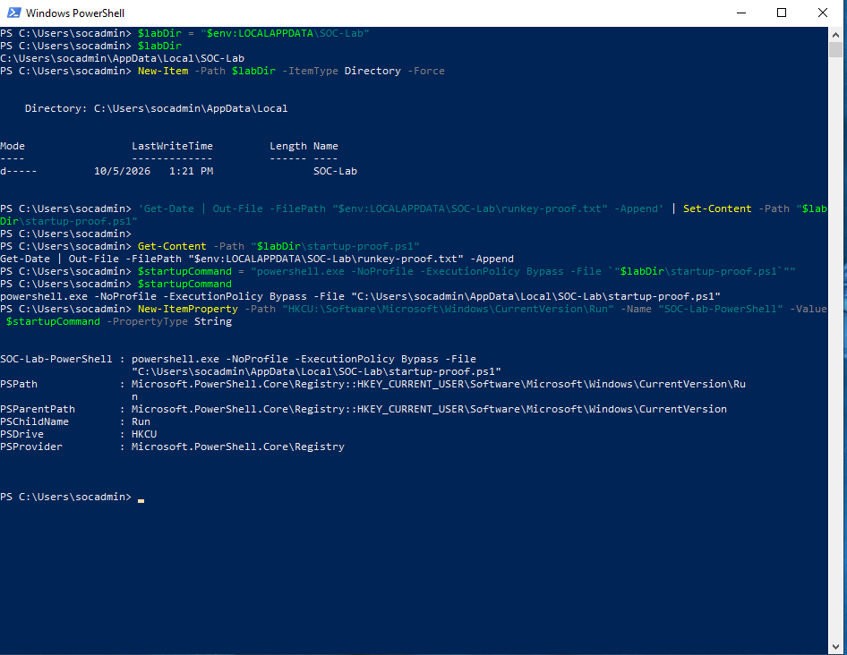
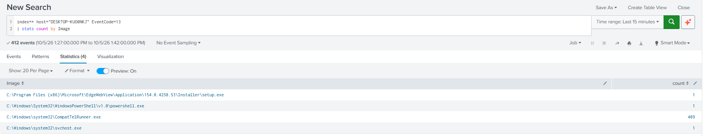
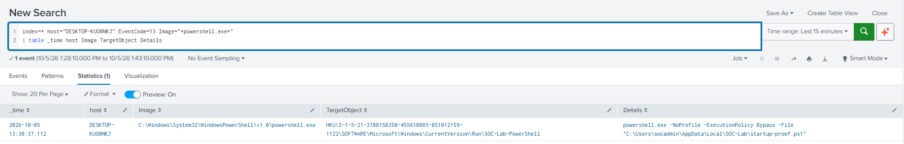
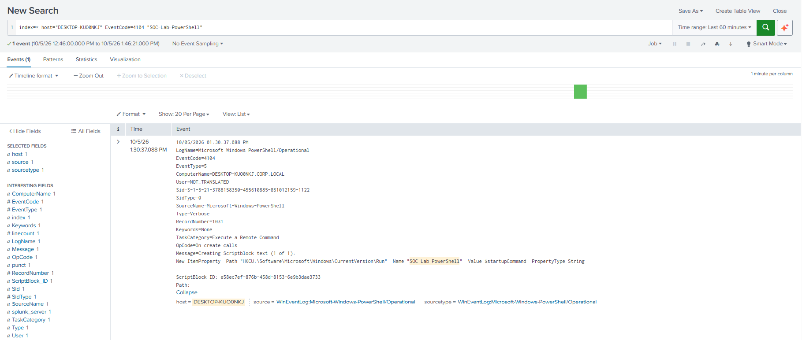
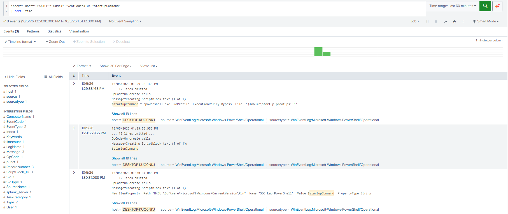
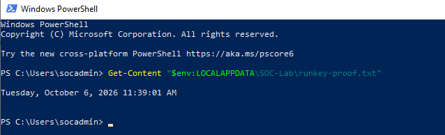
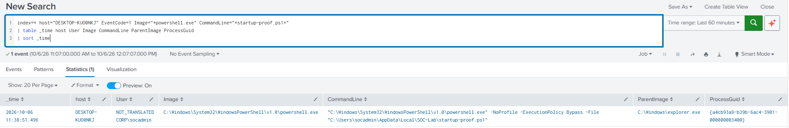
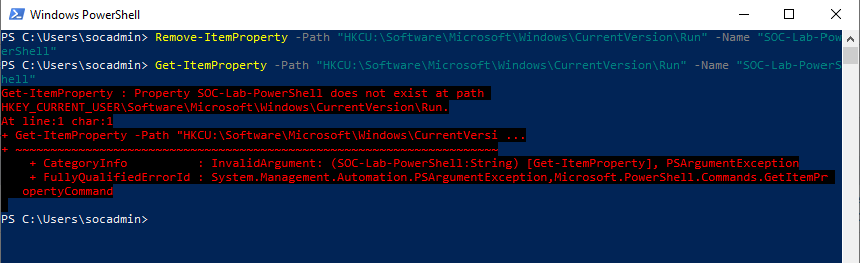

# PowerShell and Registry Run Key Persistence Investigation

## Detection Summary

This lab investigates persistence configured through PowerShell and a per-user Windows Registry Run value.

PowerShell created a startup entry referencing a harmless script. At the next user sign-in, Windows launched PowerShell to execute that script, which wrote a timestamp to a local file.

The investigation combined:

- PowerShell Event ID `4104` — Script Block Logging.
- Sysmon Event ID `13` — Registry Value Set.
- Sysmon Event ID `1` — Process Creation.
- A local proof file containing the script's output.

The startup value was removed after validation.

The events were correlated manually. No automated correlation rule or alert was implemented.

---

## Objective

The objective of this lab was to:

- Create a harmless PowerShell script.
- Configure automatic execution through a Registry Run value.
- Identify the process responsible for the Registry modification.
- Reconstruct the startup command using PowerShell script block logs.
- Confirm the actual command written to the Registry.
- Investigate subsequent process creation after user sign-in.
- Verify that the script performed its intended action.
- Build a timeline connecting configuration and execution.
- Remove the persistence value and verify cleanup.

---

## MITRE ATT&CK

| Technique | ID |
|---|---|
| Boot or Logon Autostart Execution: Registry Run Keys / Startup Folder | T1547.001 |
| Command and Scripting Interpreter: PowerShell | T1059.001 |

These mappings describe the simulated behavior. The script used in this exercise was benign.

---

## Lab Environment

| Component | Role |
|---|---|
| Windows 10 | Target Workstation |
| Windows PowerShell | Registry Configuration and Script Execution |
| Sysmon | Endpoint Telemetry |
| PowerShell Script Block Logging | PowerShell Code Visibility |
| Splunk Universal Forwarder | Log Forwarding |
| Splunk Enterprise | SIEM |

Host:

```text
DESKTOP-KUOONKJ
```

User account:

```text
CORP\socadmin
```

Persistence location:

```text
HKCU\Software\Microsoft\Windows\CurrentVersion\Run
```

Registry value name:

```text
SOC-Lab-PowerShell
```

Script path:

```text
C:\Users\socadmin\AppData\Local\SOC-Lab\startup-proof.ps1
```

Output file:

```text
C:\Users\socadmin\AppData\Local\SOC-Lab\runkey-proof.txt
```

---

## Attack Overview

Windows Registry Run keys allow programs to execute automatically when a user signs in.

In this exercise, PowerShell created a Run value containing a command that launched a local PowerShell script.

The script appended the current date and time to a text file, providing a visible result that could be checked after sign-in.

The sequence was:

1. Create the script.
2. Prepare the startup command.
3. Write the command to the current user's Run key.
4. Sign in again with the same user.
5. Investigate the resulting PowerShell process.
6. Check the script's output.
7. Remove the Run value.

Unlike the earlier Registry lab, which used `reg.exe`, this exercise used `New-ItemProperty`. PowerShell therefore performed the Registry modification directly.

The entry applied to the current user. It did not configure execution under `SYSTEM`.

---

## Lab Configuration

Sysmon events and PowerShell script block logs were already being collected in Splunk.

The investigation used:

| Source | Event ID | Purpose |
|---|---|---|
| Microsoft-Windows-PowerShell/Operational | 4104 | Review PowerShell script block text |
| Microsoft-Windows-Sysmon/Operational | 13 | Identify the Registry value modification |
| Microsoft-Windows-Sysmon/Operational | 1 | Identify subsequent process creation |

No additional logging configuration was introduced during this exercise.

The activity took place across October 5–6, 2026.

When repeating the searches for historical review, the selected time range must include the relevant dates. The relative time ranges visible in the screenshots applied when those searches were originally run.

---

## Attack Execution

### Create the Lab Directory

The following commands were executed in PowerShell on the Windows 10 VM:

```powershell
$labDir = "$env:LOCALAPPDATA\SOC-Lab"
```

The resulting path was:

```text
C:\Users\socadmin\AppData\Local\SOC-Lab
```

The directory was created using:

```powershell
New-Item -Path $labDir -ItemType Directory -Force
```

---

### Create the Harmless Script

The script was written using:

```powershell
'Get-Date | Out-File -FilePath "$env:LOCALAPPDATA\SOC-Lab\runkey-proof.txt" -Append' | Set-Content -Path "$labDir\startup-proof.ps1"
```

The single-quoted text was saved to the script file without executing it.

Its contents were verified using:

```powershell
Get-Content -Path "$labDir\startup-proof.ps1"
```

Script contents:

```powershell
Get-Date | Out-File -FilePath "$env:LOCALAPPDATA\SOC-Lab\runkey-proof.txt" -Append
```

When executed:

- `Get-Date` obtains the current date and time.
- `Out-File` writes the output to the proof file.
- `-Append` preserves existing content and adds the new output.

The script performed no download, credential access or destructive action.

---

### Prepare the Startup Command

The startup command was stored in a variable:

```powershell
$startupCommand = "powershell.exe -NoProfile -ExecutionPolicy Bypass -File `"$labDir\startup-proof.ps1`""
```

The value was displayed using:

```powershell
$startupCommand
```

Result:

```text
powershell.exe -NoProfile -ExecutionPolicy Bypass -File "C:\Users\socadmin\AppData\Local\SOC-Lab\startup-proof.ps1"
```

| Argument | Purpose |
|---|---|
| `-NoProfile` | Prevent loading the PowerShell profile |
| `-ExecutionPolicy Bypass` | Request a process-scoped execution policy |
| `-File` | Specify the script to execute |

The execution policy argument did not make a permanent machine-wide policy change or elevate the process's privileges.

---

### Create the Registry Run Value

The startup entry was created using:

```powershell
New-ItemProperty -Path "HKCU:\Software\Microsoft\Windows\CurrentVersion\Run" -Name "SOC-Lab-PowerShell" -Value $startupCommand -PropertyType String
```

The entry was configured with:

```text
Registry Key:
HKCU\Software\Microsoft\Windows\CurrentVersion\Run

Value Name:
SOC-Lab-PowerShell

Value Type:
REG_SZ

Value Data:
powershell.exe -NoProfile -ExecutionPolicy Bypass -File "C:\Users\socadmin\AppData\Local\SOC-Lab\startup-proof.ps1"
```

The command output showed the created value and its configured data.

---

### Verify Execution After Sign-in

On October 6, the same user signed in again and observed PowerShell opening automatically.

The script was not intentionally launched manually during this validation.

The proof file was read using:

```powershell
Get-Content "$env:LOCALAPPDATA\SOC-Lab\runkey-proof.txt"
```

Observed output:

```text
Tuesday, October 6, 2026 11:39:01 AM
```

This provided evidence that the script performed its intended write operation.

---

## Evidence Collected

### Event ID 4104 — Startup Command Preparation

PowerShell script block logs showed three relevant actions:

1. Assignment of the startup command to `$startupCommand`.
2. Evaluation of `$startupCommand` to display its value.
3. Use of the variable in `New-ItemProperty`.

Observed assignment:

```powershell
$startupCommand = "powershell.exe -NoProfile -ExecutionPolicy Bypass -File `"$labDir\startup-proof.ps1`""
```

Observed Registry configuration:

```powershell
New-ItemProperty -Path "HKCU:\Software\Microsoft\Windows\CurrentVersion\Run" -Name "SOC-Lab-PowerShell" -Value $startupCommand -PropertyType String
```

The script block text retained the variable references.

The configuration event showed:

```powershell
-Value $startupCommand
```

It did not show the expanded value at that position.

Similarly, the assignment still referenced `$labDir`.

Sysmon Event ID `13` supplied the resolved command that was actually written to the Registry.

Event `4104` provided visibility into the code. It did not independently establish that the Registry modification succeeded.

---

### Event ID 13 — Registry Value Set

Sysmon recorded PowerShell modifying the Run value.

Observed:

```text
Timestamp:
2026-10-05 13:30:37.112

Image:
C:\Windows\System32\WindowsPowerShell\v1.0\powershell.exe

TargetObject:
HKU\<User SID>\SOFTWARE\Microsoft\Windows\CurrentVersion\Run\SOC-Lab-PowerShell

Details:
powershell.exe -NoProfile -ExecutionPolicy Bypass -File "C:\Users\socadmin\AppData\Local\SOC-Lab\startup-proof.ps1"
```

The fields had different roles:

| Field | Meaning |
|---|---|
| `Image` | Process responsible for modifying the Registry |
| `TargetObject` | Registry location and value name |
| `Details` | Command configured for future execution |

In this case, both `Image` and `Details` referenced PowerShell, but they described separate actions.

Sysmon represented the current user's Registry hive as:

```text
HKU\<User SID>
```

This corresponded to the user-specific location accessed through `HKCU`.

Event `13` confirmed that the startup value was set. It did not prove that the configured command subsequently executed.

---

### Event ID 1 — Process Creation

After the subsequent sign-in, Sysmon recorded a PowerShell process executing the configured script.

Observed:

```text
Timestamp:
2026-10-06 11:38:51.496

Image:
C:\Windows\System32\WindowsPowerShell\v1.0\powershell.exe

ParentImage:
C:\Windows\explorer.exe

User:
CORP\socadmin

CommandLine:
"C:\Windows\System32\WindowsPowerShell\v1.0\powershell.exe" -NoProfile -ExecutionPolicy Bypass -File "C:\Users\socadmin\AppData\Local\SOC-Lab\startup-proof.ps1"
```

The executable, arguments and script path matched the startup configuration.

The Registry data used:

```text
powershell.exe
```

The process creation event recorded the executable's full path.

The `ParentImage` was consistent with execution during user sign-in. However, `explorer.exe` can also launch programs manually, so its presence alone does not prove Run key execution.

The conclusion was supported by:

- The previously configured Run value.
- The matching process command line.
- The observed automatic PowerShell launch after sign-in.
- The timestamp written by the script.

The displayed `User` column contained both `NOT_TRANSLATED` and `CORP\socadmin`. Event metadata must be distinguished from the process execution account; these values should not be treated as two separate execution users.

---

### Proof File — Script Output

The proof file contained:

```text
Tuesday, October 6, 2026 11:39:01 AM
```

This was approximately 9.5 seconds after the recorded PowerShell process creation.

Event `1` established that the process was created with the script argument. The proof file supplied additional evidence that the script performed its intended action.

The proof file is a controlled-lab validation artifact, not an independently tamper-resistant audit source.

---

## Splunk Detection

### Identify Processes Modifying Registry Values

```spl
index=* host="DESKTOP-KUOONKJ" EventCode=13
| stats count by Image
```

The captured search returned:

| Process | Event Count |
|---|---:|
| `CompatTelRunner.exe` | 409 |
| `powershell.exe` | 1 |
| EdgeWebView installer `setup.exe` | 1 |
| `svchost.exe` | 1 |

These were counts of Registry value modifications in the selected time window.

They were not counts of persistence events or malicious processes.

The search helped identify PowerShell for further investigation.

---

### Investigate Registry Modifications by PowerShell

```spl
index=* host="DESKTOP-KUOONKJ" EventCode=13 Image="*powershell.exe*"
| table _time host Image TargetObject Details
```

This search returned the lab Run value modification in the captured window.

The query itself is broader than Run key persistence. Analysts must review `TargetObject` to determine which Registry location was modified.

Important fields:

```text
Image
TargetObject
Details
```

---

### Find the Known Lab Value

```spl
index=* host="DESKTOP-KUOONKJ" EventCode=13 "SOC-Lab-PowerShell"
| table _time host Image TargetObject Details
```

This focused search uses the known test value name.

It is useful for validating the lab activity but would not detect entries using unrelated names.

---

### Find the Registry Configuration Script Block

```spl
index=* host="DESKTOP-KUOONKJ" EventCode=4104 "SOC-Lab-PowerShell"
```

The result contained:

```powershell
New-ItemProperty -Path "HKCU:\Software\Microsoft\Windows\CurrentVersion\Run" -Name "SOC-Lab-PowerShell" -Value $startupCommand -PropertyType String
```

The event exposed the Registry path, value name and command responsible for requesting the modification.

---

### Reconstruct the Startup Command

```spl
index=* host="DESKTOP-KUOONKJ" EventCode=4104 "startupCommand"
| sort _time
```

This search showed the variable's preparation and subsequent use.

The script blocks were compared with the resolved Registry data in Event `13`.

Together, the sources explained how the command was prepared and what was actually stored.

---

### Identify Execution of the Startup Script

```spl
index=* host="DESKTOP-KUOONKJ" EventCode=1 Image="*powershell.exe" CommandLine="*startup-proof.ps1*"
| table _time host User Image CommandLine ParentImage ProcessGuid
| sort _time
```

The captured result showed one matching PowerShell process.

Important fields:

```text
User
Image
CommandLine
ParentImage
ProcessGuid
```

This is a follow-up investigation query for the known lab script. It is not a general-purpose malicious PowerShell detection.

For production use, scope searches to the appropriate indices and event sources, validate field extractions, and tune against expected administrative and application activity.

---

## Detection Logic

The investigation connected configuration, execution and observable output.

| Stage | Evidence | What It Establishes |
|---|---|---|
| Prepare the command | PowerShell 4104 | Script text defining the startup command |
| Configure persistence | PowerShell 4104 and Sysmon 13 | The configuration command and the resulting Registry data |
| Launch the configured program | Sysmon 1 | PowerShell process creation with the matching script argument |
| Perform the script action | Proof file | Timestamp output from the script |
| Remove persistence | Cleanup console output | Absence of the named Run value after removal |

The events were connected through:

- Host.
- Registry value name.
- Script path.
- Command-line arguments.
- User context.
- Timestamps.

The PowerShell process that configured the Registry and the PowerShell process launched at the next sign-in were separate process instances.

Their `ProcessGuid` values should not be assumed to match.

No automated cross-source correlation was implemented.

---

## Detection Workflow

1. Review Registry value modifications.
2. Identify PowerShell as the modifying process.
3. Inspect the Run value and its configured command.
4. Search PowerShell script blocks for the configuration command.
5. Reconstruct the startup command's preparation.
6. Search subsequent process creation events for the configured script.
7. Compare the host, user, command line, parent and timestamps.
8. Check the script's intended output.
9. Assess whether the startup configuration is expected.
10. Remove the test value and verify its absence.

Observed timeline:

| Timestamp | Evidence | Activity |
|---|---|---|
| 2026-10-05 13:29:38.168 | PowerShell 4104 | Assigned the startup command to `$startupCommand` |
| 2026-10-05 13:29:56.956 | PowerShell 4104 | Evaluated `$startupCommand` for console display |
| 2026-10-05 13:30:37.088 | PowerShell 4104 | Ran the `New-ItemProperty` configuration command |
| 2026-10-05 13:30:37.112 | Sysmon 13 | Set the `SOC-Lab-PowerShell` Run value |
| 2026-10-06 11:38:51.496 | Sysmon 1 | Created PowerShell with the startup script argument |
| 2026-10-06 11:39:01 | Proof file | Recorded the script's timestamp output |
| After validation | Cleanup console | Removed the Run value and verified its absence |

Times are reproduced as displayed in the screenshots. The images do not expose an explicit UTC offset, so these values have not been independently normalized to UTC.

The cleanup screenshot does not contain an exact timestamp.

---

## False Positives and Limitations

Registry Run values and PowerShell are also used for legitimate purposes.

Expected activity may include:

- Application startup configuration.
- Approved administrative scripts.
- Software installation and updates.
- User-specific automation.

A matching event requires investigation before classification as malicious.

Potentially suspicious findings include unexpected startup scripts, unfamiliar file locations, unusual arguments or changes without an approved business purpose.

Important limitations:

- Event `4104` records script block text, which can retain variable references.
- Event `13` confirms a Registry value set, not successful future execution.
- Event `1` confirms process creation, not successful completion of every script instruction.
- An `explorer.exe` parent does not independently prove Run key execution.
- `-ExecutionPolicy Bypass` alone does not establish malicious intent.
- The proof file can be modified and is not an independent security log.
- No logon event is included in this evidence set.
- No Event `4104` showing the startup script's execution is included.
- Cleanup was verified through console output; no Registry deletion event is claimed.
- Visibility depends on logging configuration, forwarding, field extraction and the selected search period.

The sign-in context was supported by the controlled test and the observed automatic launch.

---

## Mitigation

Possible defensive measures include:

- Monitor unexpected changes to Run and RunOnce locations.
- Investigate startup entries invoking script interpreters.
- Review scripts stored in user-writable directories.
- Validate file contents, origin, signatures and business purpose.
- Collect Registry, process creation and PowerShell telemetry together.
- Use application control where appropriate.
- Preserve relevant evidence before removing unauthorized startup values.
- Verify that removed persistence entries are not recreated.

Standard users can configure startup entries in their own Registry hive.

Restricting administrative privileges alone does not prevent this per-user persistence mechanism.

---

## Cleanup

The Run value was removed using:

```powershell
Remove-ItemProperty -Path "HKCU:\Software\Microsoft\Windows\CurrentVersion\Run" -Name "SOC-Lab-PowerShell"
```

Its absence was verified using:

```powershell
Get-ItemProperty -Path "HKCU:\Software\Microsoft\Windows\CurrentVersion\Run" -Name "SOC-Lab-PowerShell"
```

The returned error stated that the `SOC-Lab-PowerShell` property did not exist at the specified Registry path.

This was the expected result and confirmed removal of the startup value.

Only the named lab value was deleted.

The script and proof file were retained for documentation. Historical Splunk events remained available for analysis.

Removing the Run value prevents future execution through that entry. It does not terminate an already running process.

---

## Screenshots

The screenshots below are stored in the `screenshots/` subdirectory.

### Script and Registry Setup

Creation of the lab directory, script, startup command and Registry Run value.



### Registry Modification Counts by Process

Exploratory Event `13` search identifying the processes responsible for Registry modifications in the selected window.



### PowerShell Registry Persistence Configuration

Event `13` showing PowerShell modifying the Run value and the fully expanded command stored in `Details`.



### Registry Configuration Script Block

Event `4104` containing `New-ItemProperty` and the `$startupCommand` reference.



### Startup Command Preparation

Three script blocks showing assignment, console evaluation and use of the startup command.



### Script Output After Sign-in

The proof file containing the timestamp written by the script.



### PowerShell Process Creation

Event `1` showing the matching script argument, execution user and `explorer.exe` parent.



### Registry Value Removal

Removal of the test value and the expected property-not-found verification result.



---

## Lessons Learned

This lab demonstrated how to investigate a persistence sequence across multiple sources rather than relying on a single event.

PowerShell script block logs explained how the startup command was prepared and used. Sysmon Event `13` confirmed the actual command written to the Registry.

The following day's Event `1` showed PowerShell executing with the configured script argument. The proof file provided additional evidence that the script performed its intended action.

The exercise highlighted the distinction between configuring persistence, creating a process and verifying the result of execution.

It also demonstrated the importance of interpreting variable references, separating event metadata from execution context, selecting an appropriate search period and verifying cleanup.
