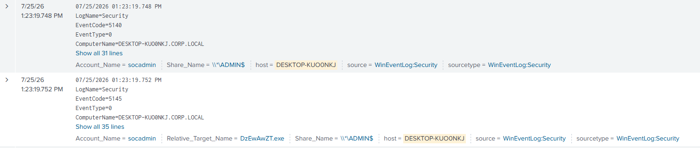
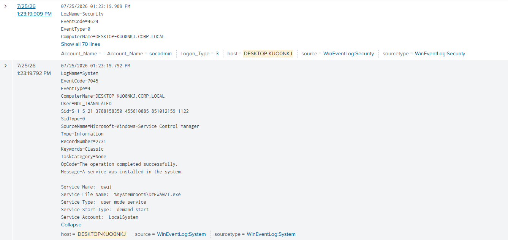

# PsExec Lateral Movement Detection

## Overview

This lab demonstrates lateral movement using Impacket's PsExec implementation against a domain-joined Windows 10 workstation.

The attack was performed from a Kali Linux machine using a privileged domain account. PsExec authenticated to the target over SMB, accessed the `ADMIN$` administrative share, uploaded a temporary executable, created a Windows service, and executed the payload as `NT AUTHORITY\SYSTEM`.

The activity was investigated using Windows Security logs, System logs, Sysmon, and Splunk.

## Lab Environment

| System | Role |
|---|---|
| Kali Linux | Attacker |
| Windows 10 | Target workstation |
| Windows Server 2022 | Domain Controller |
| Splunk Enterprise | SIEM |
| Sysmon | Endpoint telemetry |

Domain:

`CORP.LOCAL`

---

## Attack Execution

The attack was performed using Impacket PsExec:

```bash
impacket-psexec CORP.LOCAL/socadmin:'<REDACTED>'@<TARGET-IP>
```

Successful execution resulted in a remote shell running as:

```text
NT AUTHORITY\SYSTEM
```

---

## Detection & Investigation

### 1. Network Authentication — Event ID 4624

Windows recorded a successful network logon for the privileged domain account.

Key indicators:

- Event ID: `4624`
- Account: `socadmin`
- Logon Type: `3`
- Target: Windows 10 workstation

Logon Type 3 indicates authentication over the network, consistent with SMB-based remote access.

```spl
index=* host="DESKTOP-KUOONKJ" EventCode=4624 Account_Name="socadmin"
```

---

### 2. Administrative Share Access — Event ID 5140

File Share auditing recorded access to the built-in administrative share:

```text
\\*\ADMIN$
```

Key indicators:

- Event ID: `5140`
- Account: `socadmin`
- Share: `ADMIN$`

```spl
index=* host="DESKTOP-KUOONKJ" EventCode=5140 Account_Name="socadmin"
```

This activity is consistent with PsExec accessing the administrative share before transferring its service executable.



---

### 3. Detailed Share Access — Event ID 5145

Detailed File Share auditing exposed the executable accessed through `ADMIN$`.

Observed:

```text
Relative Target Name: DzEwAwZT.exe
Share Name: \\*\ADMIN$
Account Name: socadmin
```

The randomly named executable is significant because the same filename appears in the subsequent service creation and process execution telemetry.

```spl
index=* host="DESKTOP-KUOONKJ" EventCode=5145 Account_Name="socadmin"
```

---

### 4. Service Creation — Event ID 7045

Immediately following the SMB activity, Windows Service Control Manager recorded the installation of a new service.

Observed:

```text
Service Name: qWQj
Service File Name: %systemroot%\DzEwAwZT.exe
Service Type: user mode service
Service Start Type: demand start
Service Account: LocalSystem
```

```spl
index=* host="DESKTOP-KUOONKJ" EventCode=7045
```

The service executable matches the file observed through `ADMIN$` in Event ID 5145.



---

### 5. Process Execution — Sysmon Event ID 1

Sysmon captured execution of the uploaded executable.

Observed:

```text
Image:
C:\Windows\DzEwAwZT.exe

ParentImage:
C:\Windows\System32\services.exe

User:
NT AUTHORITY\SYSTEM
```

```spl
index=* host="DESKTOP-KUOONKJ" EventCode=1 Image="C:\\Windows\\DzEwAwZT.exe"
| table _time Image ParentImage CommandLine User
```

This confirms that the executable installed as a service was launched by `services.exe` with SYSTEM privileges.


---

## Attack Timeline

| Event | Activity |
|---|---|
| 13:23:19.748 | Event 5140 — `socadmin` accesses `ADMIN$` |
| 13:23:19.752 | Event 5145 — `DzEwAwZT.exe` accessed through `ADMIN$` |
| 13:23:19.792 | Event 7045 — service `qWQj` created using `DzEwAwZT.exe` |
| 13:23:19.805 | Sysmon Event 1 — `services.exe` executes `DzEwAwZT.exe` as SYSTEM |
| 13:23:19.909 | Event 4624 — additional Type 3 network logon activity |

The strongest correlation is the repeated executable name:

```text
5145
ADMIN$\DzEwAwZT.exe
        ↓
7045
%systemroot%\DzEwAwZT.exe
        ↓
Sysmon Event 1
C:\Windows\DzEwAwZT.exe
        ↓
NT AUTHORITY\SYSTEM
```

This links SMB administrative share activity, service creation, and SYSTEM-level process execution.

---

## Detection Logic

A single event is not sufficient to reliably identify PsExec activity.

Higher-confidence detection can be achieved by correlating:

1. Network logon (`4624`, Logon Type 3)
2. Administrative share access (`5140/5145`)
3. Executable access through `ADMIN$`
4. New service creation (`7045`)
5. Service-backed process execution (`Sysmon Event 1`)
6. Execution under `NT AUTHORITY\SYSTEM`

Potentially suspicious patterns include:

- Administrative share access followed by service creation
- Executables written through `ADMIN$`
- Randomly named services and executables
- `services.exe` spawning an unusual executable
- Remote administrative activity followed by SYSTEM execution

---

## MITRE ATT&CK Mapping

- **T1021.002 — Remote Services: SMB/Windows Admin Shares**
- **T1569.002 — System Services: Service Execution**

---

## Key Takeaways

This exercise demonstrated how PsExec-style lateral movement produces artifacts across multiple Windows log sources.

Rather than relying on a single event, correlating authentication, SMB share access, service installation, and process creation provides significantly stronger evidence of remote service execution.

The lab also demonstrated the importance of enabling appropriate audit policies. Events `5140` and `5145` were only available after File Share and Detailed File Share auditing were enabled.
