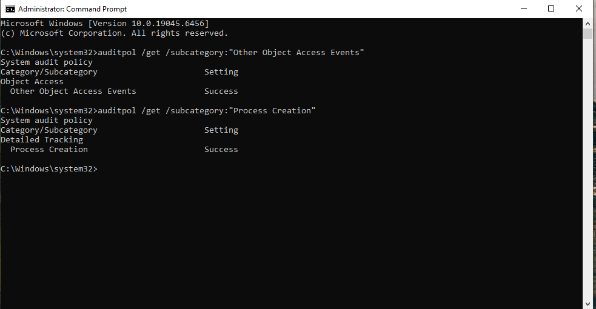
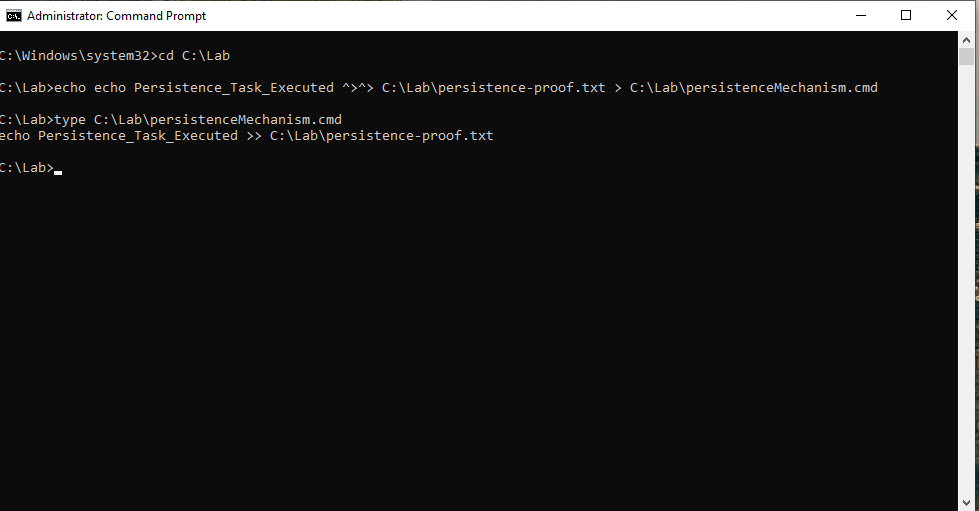
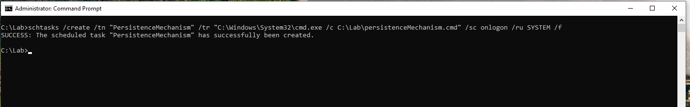
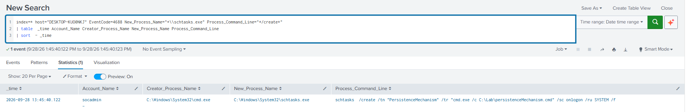
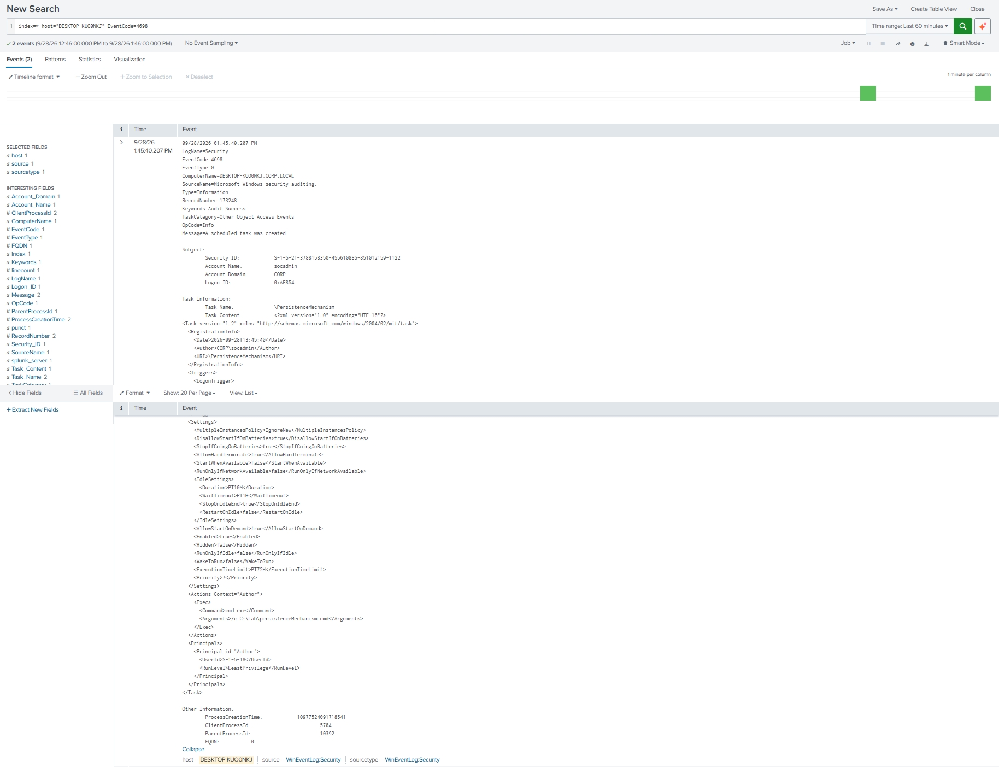

# Scheduled Task Persistence Detection

## Detection Summary

This detection identifies persistence established through the creation of a Windows Scheduled Task.

The activity was detected by correlating Windows Security Event ID `4688`, which recorded the execution of `schtasks.exe`, with Event ID `4698`, which recorded the registration of the scheduled task.

---

## Objective

The objective of this lab was to:

- Simulate persistence using a Windows Scheduled Task.
- Configure the required Windows auditing.
- Create a scheduled task using `schtasks.exe`.
- Configure the task to execute when a user logs on.
- Configure the task to run under the `SYSTEM` account.
- Detect the process responsible for creating the task.
- Identify the registered scheduled task through Windows Security telemetry.
- Investigate the activity in Splunk.

---

## MITRE ATT&CK

| Technique | ID |
|---|---|
| Scheduled Task/Job: Scheduled Task | T1053.005 |

---

## Lab Environment

| Machine | Role |
|---|---|
| Windows 10 | Target Workstation |
| Windows Server 2022 | Domain Controller |
| Splunk Enterprise | SIEM |

Additional telemetry:

- Windows Security Logs
- Splunk Universal Forwarder

Domain:

```text
CORP.LOCAL
```

---

## Attack Overview

Windows Scheduled Tasks allow programs or scripts to execute automatically when specific conditions are met.

Scheduled Tasks are commonly used for legitimate administrative purposes but can also be abused to establish persistence.

An attacker with sufficient privileges can create a task configured to execute:

- At user logon
- At system startup
- At a specific time
- At recurring intervals

In this lab, a scheduled task was created with a logon trigger and configured to execute a command under the `SYSTEM` account.

The task executed a harmless script stored in:

```text
C:\Lab\persistenceMechanism.cmd
```

The script was configured to append text to:

```text
C:\Lab\persistence-proof.txt
```

---

## Lab Configuration

Windows Security auditing was configured before creating the scheduled task.

The following audit policies were verified:

```cmd
auditpol /get /subcategory:"Other Object Access Events"
auditpol /get /subcategory:"Process Creation"
```

Both policies returned:

```text
Success
```

`Other Object Access Events` was required to generate Event ID `4698` when a scheduled task was created.

`Process Creation` auditing allowed Windows to record Event ID `4688` when `schtasks.exe` was executed.

A benign persistence script was created:

```cmd
echo echo Persistence_Task_Executed ^>^> C:\Lab\persistence-proof.txt > C:\Lab\persistenceMechanism.cmd
```

The contents were verified using:

```cmd
type C:\Lab\persistenceMechanism.cmd
```

Result:

```text
echo Persistence_Task_Executed >> C:\Lab\persistence-proof.txt
```

---

## Attack Execution

The scheduled task was created from an elevated Command Prompt using:

```cmd
schtasks /create /tn "PersistenceMechanism" /tr "C:\Windows\System32\cmd.exe /c C:\Lab\persistenceMechanism.cmd" /sc onlogon /ru SYSTEM /f
```

The task was configured with:

```text
Task Name:
PersistenceMechanism

Trigger:
User Logon

Execution Account:
SYSTEM

Action:
cmd.exe /c C:\Lab\persistenceMechanism.cmd
```

Windows confirmed successful creation of the task.

---

## Evidence Collected

Two important Windows Security events were identified during the investigation.

### Event ID 4688 — Process Creation

Windows recorded the execution of `schtasks.exe`.

Observed:

```text
Account Name:
socadmin

Creator Process:
C:\Windows\System32\cmd.exe

New Process:
C:\Windows\System32\schtasks.exe
```

The command line revealed the complete scheduled task creation command:

```text
schtasks /create /tn "PersistenceMechanism" /tr "cmd.exe /c C:\Lab\persistenceMechanism.cmd" /sc onlogon /ru SYSTEM /f
```

This provided several important indicators:

```text
/create
```

indicated creation of a new scheduled task.

```text
/tn "PersistenceMechanism"
```

identified the task name.

```text
/sc onlogon
```

configured the task to execute when a user logs on.

```text
/ru SYSTEM
```

configured the task to execute under the `SYSTEM` account.

The observed process relationship was:

```text
cmd.exe
    ↓
schtasks.exe
    ↓
Scheduled Task Creation
```

---

### Event ID 4698 — Scheduled Task Created

Windows Security auditing recorded the successful registration of the scheduled task.

Observed:

```text
Account Name:
socadmin

Account Domain:
CORP

Task Name:
\PersistenceMechanism
```

The task XML contained the configured trigger:

```text
LogonTrigger
```

The configured action was:

```text
Command:
cmd.exe

Arguments:
/c C:\Lab\persistenceMechanism.cmd
```

The task principal contained:

```text
UserId:
S-1-5-18
```

SID `S-1-5-18` represents:

```text
LOCAL SYSTEM
```

This confirmed that the scheduled task was configured to execute under the SYSTEM security context.

---

## Splunk Detection

### Detect Scheduled Task Creation

```spl
index=* host="DESKTOP-KUOONKJ" EventCode=4698
| sort - _time
```

Important information contained within Event ID `4698` includes:

```text
Account_Name
Task_Name
Task_Content
Command
Arguments
Trigger
UserId
```

Analysts should inspect newly created scheduled tasks for unusual commands, execution paths, triggers, and privileged execution contexts.

---

### Detect Scheduled Task Creation Through schtasks.exe

```spl
index=* host="DESKTOP-KUOONKJ" EventCode=4688
New_Process_Name="*\\schtasks.exe"
Process_Command_Line="*/create*"
| table _time Account_Name Creator_Process_Name New_Process_Name Process_Command_Line
| sort - _time
```

This search identifies process creation events where `schtasks.exe` was used with the `/create` argument.

Important fields include:

```text
Account_Name
Creator_Process_Name
New_Process_Name
Process_Command_Line
```

The command line can reveal:

- Scheduled task name
- Trigger type
- Executed command
- Script path
- Execution account

---

## Detection Logic

Scheduled Task persistence becomes suspicious when a new task is registered and the process responsible for its creation can be identified.

The observed activity produced:

```text
socadmin
    ↓
cmd.exe
    ↓
schtasks.exe
    ↓
/create
    ↓
PersistenceMechanism
    ↓
Logon Trigger
    ↓
SYSTEM
    ↓
cmd.exe /c C:\Lab\persistenceMechanism.cmd
```

Event ID `4688` provided visibility into the command used to create the task.

Event ID `4698` provided visibility into the scheduled task configuration registered with Windows.

Together, the events reveal both the creation mechanism and the resulting persistence configuration.

---

## Detection Workflow

1. Search for Event ID `4698` to identify newly created scheduled tasks.
2. Inspect the task name and task XML.
3. Identify the configured trigger.
4. Review the command and arguments executed by the task.
5. Determine the account under which the task will execute.
6. Search Event ID `4688` for executions of `schtasks.exe`.
7. Identify command lines containing `/create`.
8. Review the user and parent process responsible for creating the task.
9. Compare the process creation telemetry with the registered task configuration.

Observed timeline:

| Timestamp | Event | Activity |
|---|---|---|
| 13:45:40.122 | 4688 | `socadmin` executed `schtasks.exe /create` |
| 13:45:40.207 | 4698 | Scheduled task `PersistenceMechanism` registered |

The events occurred within the same second and describe the same scheduled task creation activity.

---

## Mitigation

Possible defensive measures include:

- Restrict administrative privileges.
- Apply least privilege to user and service accounts.
- Monitor newly created and modified scheduled tasks.
- Enable `Other Object Access Events` auditing.
- Enable Process Creation auditing with command-line logging.
- Monitor executions of `schtasks.exe`.
- Investigate scheduled tasks configured to run as `SYSTEM`.
- Investigate tasks executing scripts from unusual or user-writable directories.
- Monitor command interpreters such as `cmd.exe` and `powershell.exe` when used by scheduled tasks.
- Deploy endpoint protection capable of monitoring Scheduled Task activity.

---

## Screenshots

### Audit Policy Configuration

Windows auditing configured for Process Creation and Other Object Access Events.



### Persistence Script Creation

Creation and verification of the benign persistence script.



### Scheduled Task Creation

Creation of the `PersistenceMechanism` scheduled task using `schtasks.exe`.



### Event ID 4688 — Process Creation

Splunk detection showing `schtasks.exe` executed by `socadmin` with the `/create` argument.



### Event ID 4698 — Scheduled Task Created

Windows Security Event ID `4698` showing the registered task configuration, logon trigger, command, arguments, and SYSTEM execution context.



---

## Lessons Learned

This lab demonstrated how Windows Scheduled Tasks can be used to establish persistence and how the activity can be detected using native Windows Security telemetry.

Event ID `4688` provided visibility into the process responsible for creating the scheduled task. The command line revealed the use of `schtasks.exe`, the `/create` argument, the scheduled task name, the logon trigger, the configured command, and the SYSTEM execution account.

Event ID `4698` provided detailed information about the task registered with Windows. The task XML revealed the trigger, execution command, arguments, and the security context under which the task was configured to run.

The lab also demonstrated the importance of audit configuration. Event ID `4698` was not available until `Other Object Access Events` auditing was enabled.

Monitoring both process creation and scheduled task registration provides stronger visibility into persistence activity than relying on scheduled task names alone.
