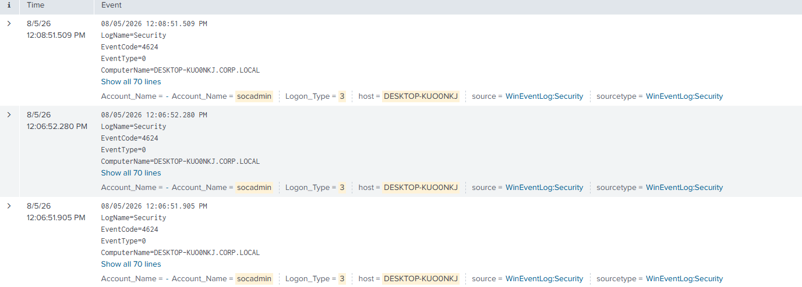
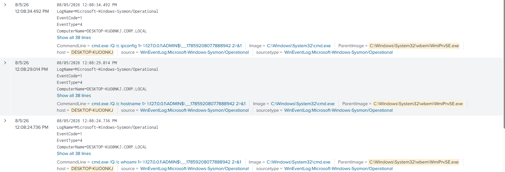

# WMI Remote Execution Detection

## Detection Summary

This detection identifies remote command execution performed through Windows Management Instrumentation (WMI) using Impacket's `wmiexec.py`.

The attack was detected by correlating successful Windows authentication with Sysmon process creation telemetry, revealing `WmiPrvSE.exe` spawning remote command execution.

---

## Objective

The objective of this lab was to:

- Simulate remote command execution using Windows Management Instrumentation.
- Authenticate remotely using a privileged domain account.
- Identify successful network authentication.
- Detect WMI process execution.
- Analyze Sysmon process creation telemetry.
- Reconstruct the complete attack timeline in Splunk.

---

## MITRE ATT&CK

| Technique | ID |
|---|---|
| Windows Management Instrumentation | T1047 |

---

## Lab Environment

| Machine | Role |
|---|---|
| Kali Linux | Attacker |
| Windows 10 | Target Workstation |
| Windows Server 2022 | Domain Controller |
| Splunk Enterprise | SIEM |

Additional telemetry:

- Windows Security Logs
- Sysmon
- Splunk Universal Forwarder

Domain:

```text
CORP.LOCAL
```

---

## Attack Overview

Windows Management Instrumentation (WMI) is a built-in Windows management framework that allows administrators to remotely execute commands on Windows systems.

Impacket's `wmiexec.py` performs several actions on the target:

1. Authenticates to the target.
2. Creates a remote WMI process.
3. Executes commands through `cmd.exe`.
4. Redirects command output to the `ADMIN$` administrative share.
5. Retrieves the command output over SMB.
6. Provides a remote command shell.

This generates authentication and process creation telemetry that can be correlated to identify remote WMI execution.

---

## Lab Configuration

The Windows 10 workstation was joined to the `CORP.LOCAL` Active Directory domain.

A privileged domain account was used to perform the remote administration activity.

Remote WMI execution required enabling the Windows Firewall rules for Windows Management Instrumentation.

The following firewall rules were enabled:

```text
Windows Management Instrumentation (WMI)
├── DCOM-In
├── WMI-In
├── WMI-Out
└── ASync-In
```

The firewall rules were enabled using:

```powershell
Enable-NetFirewallRule -DisplayGroup "Windows Management Instrumentation (WMI)"
```

This allowed remote WMI connections from Kali Linux.

---

## Attack Execution

The attack was executed from Kali Linux using Impacket WMIExec:

```bash
impacket-wmiexec CORP.LOCAL/socadmin:'<REDACTED>'@<TARGET-IP>
```

Several commands were executed remotely:

```cmd
whoami
hostname
ipconfig
```

Successful execution resulted in a remote command shell on the Windows 10 workstation.

---

## Evidence Collected

Several events were generated during the WMI execution.

### Event ID 4624 — Successful Network Logon

Successful network authentication was observed for:

```text
Account Name: socadmin
Logon Type: 3
```

Logon Type `3` represents a network logon and is consistent with remote WMI authentication.

---

### Sysmon Event ID 1 — Process Creation

Sysmon recorded multiple remote command executions.

Observed:

```text
Image:
C:\Windows\System32\cmd.exe

ParentImage:
C:\Windows\System32\wbem\WmiPrvSE.exe
```

Command lines included:

```text
cmd.exe /Q /c whoami
cmd.exe /Q /c hostname
cmd.exe /Q /c ipconfig
```

The command line also showed output redirection through the administrative share:

```text
\\127.0.0.1\ADMIN$
```

This behavior is characteristic of Impacket's `wmiexec.py`.

---

## Splunk Detection

### Detect Successful Network Authentication

```spl
index=* host="DESKTOP-KUOONKJ" EventCode=4624 Account_Name="socadmin"
```

Look for:

```text
Logon_Type=3
```

---

### Detect WMI Process Creation

```spl
index=* host="DESKTOP-KUOONKJ" EventCode=1 ParentImage="*WmiPrvSE.exe*"
| table _time Image ParentImage CommandLine User
```

Look for:

- ParentImage = `WmiPrvSE.exe`
- Image = `cmd.exe`
- Suspicious command execution

---

## Detection Logic

WMI activity becomes significantly more suspicious when authentication events are correlated with Sysmon process creation telemetry.

The observed attack produced:

```text
4624 — Logon Type 3
        ↓
Sysmon Event 1
        ↓
WmiPrvSE.exe
        ↓
cmd.exe
        ↓
whoami
hostname
ipconfig
```

A particularly strong indicator was the parent-child process relationship:

```text
WmiPrvSE.exe
        ↓
cmd.exe
```

This relationship strongly indicates remote WMI command execution.

---

## Detection Workflow

1. Identify successful network authentication using Event ID `4624`.
2. Confirm Logon Type `3`.
3. Search Sysmon Event ID `1`.
4. Identify processes spawned by `WmiPrvSE.exe`.
5. Review executed command lines.
6. Correlate all events by hostname and timestamp.

Observed timeline:

| Timestamp | Event | Activity |
|---|---|---|
| 12:06:51 | 4624 | Successful network logon |
| 12:06:52 | 4624 | Additional network authentication |
| 12:08:24 | Sysmon 1 | `cmd.exe` executed `whoami` |
| 12:08:29 | Sysmon 1 | `cmd.exe` executed `hostname` |
| 12:08:34 | Sysmon 1 | `cmd.exe` executed `ipconfig` |

---

## Mitigation

Possible defensive measures include:

- Restrict remote WMI access.
- Limit local and domain administrator privileges.
- Restrict DCOM access where possible.
- Monitor WMI activity.
- Monitor `WmiPrvSE.exe` spawning command interpreters.
- Deploy endpoint protection capable of detecting suspicious WMI execution.
- Enable Sysmon process creation logging.
- Apply network segmentation to reduce lateral movement opportunities.

---

## Screenshots

### WMI Remote Execution

Successful remote command execution using Impacket WMIExec.

*The WMI execution console screenshot is not included in this repository.*

### Successful Network Authentication

Event ID `4624` showing successful Logon Type 3 authentication.



### Sysmon Process Creation

Sysmon Event ID `1` showing `WmiPrvSE.exe` spawning `cmd.exe`.



---

## Lessons Learned

This lab demonstrated how Windows Management Instrumentation can be abused for remote command execution using legitimate Windows functionality.

The most important finding was that Sysmon Event ID `1` provided the most valuable telemetry by capturing `cmd.exe` processes spawned by `WmiPrvSE.exe`.

The command line also revealed output redirection through the `ADMIN$` administrative share, providing additional forensic evidence of remote WMI execution.

Correlating successful authentication with WMI process creation provides strong evidence of remote command execution through Windows Management Instrumentation.
